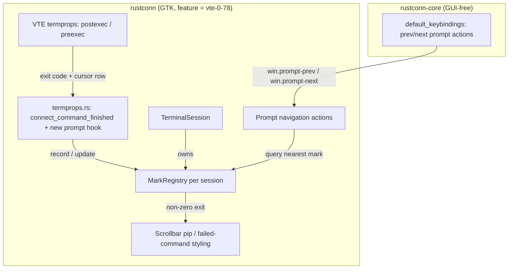

# Design Document: Shell Integration (OSC 133)

## Overview

This feature turns the OSC 133 semantic prompt sequences the remote shell emits
into three user-visible capabilities: prompt-position tracking, prompt-to-prompt
navigation, and failed-command marking. It extends what already exists in
`rustconn/src/terminal/termprops.rs` (which reads the `vte.shell.postexec`
exit-code termprop and does nothing with it) rather than replacing it.

The whole feature sits behind the existing `vte-0-78` Cargo feature. On the VTE
0.76 baseline (Ubuntu 24.04 deb, noble AppImage) every entry point compiles to a
no-op, matching the pattern `connect_command_finished` already uses, so no
supported build regresses and `settings.toml` stays portable across builds.

### What VTE gives us, and what it does not

Confirmed against the code and VTE's termprop model:

- **VTE ≥ 0.78 exposes `vte.shell.postexec`** — the OSC 133 `D` event — as a
  termprop carrying the finished command's exit code. This is already wired.
  VTE also exposes the complementary `vte.shell.preexec` (the `C` event, output
  start) in the same API family.
- **VTE provides the cursor/row position** at the moment a signal fires
  (`cursor_position`), so a prompt's screen row can be captured when the
  preexec/postexec event arrives.
- **VTE does NOT provide a built-in "jump to previous/next prompt" API** and does
  NOT expose a ready-made mark list the way Ghostty/iTerm2 do internally. The
  Mark_Registry and navigation are therefore ours to build. This is the real
  work of the feature and the reason it is the release's primary item rather than
  a flag flip.

Design consequence: a Prompt_Mark is recorded by capturing the terminal row at
the moment the shell reports a command boundary, and the registry is maintained
and queried entirely on the GTK side. We do not add a second OSC parser in front
of VTE (the `Osc52Filter` exists only because VTE drops OSC 52; OSC 133 is not
dropped — VTE consumes it and re-publishes it as termprops).

**Implementation note (vte4 0.10).** The bindings expose only the
`vte.shell.postexec` termprop, not a separate prompt-start (`A`) one. So rather
than "record on `A`, set exit on `D`", the wiring does both on `postexec`: at
command-end it records a prompt mark at the current cursor row (the line the
shell has returned the prompt to — the correct navigation target) and attaches
the exit code in the same handler. The cursor row is converted to a buffer row by
adding the scrollback offset (`vadjustment().value()`), matching the coordinate
space `highlight_overlay` documents. `MarkRegistry` collapses a repeat at the
same row and ignores an out-of-order one, so an empty Enter or a timed redraw
creates no phantom marks.

## Architecture



## Components and Interfaces

### 1. `MarkRegistry` (new, in `rustconn/src/terminal/`)

Owned per session (held by `TerminalSession`). Pure state, no GTK types in its
core logic so it can be unit-tested without a display.

```rust
/// One recorded shell prompt and the result of the command run at it.
struct PromptMark {
    /// Row in VTE's buffer coordinate space where the prompt began.
    row: i64,
    /// Exit code of the command run at this prompt, once known.
    exit_code: Option<u64>,
}

struct MarkRegistry {
    marks: Vec<PromptMark>,
}

impl MarkRegistry {
    fn record_prompt(&mut self, row: i64);
    fn set_last_exit(&mut self, code: Option<u64>);
    /// Drop marks whose row is below the current scrollback floor.
    fn trim_below(&mut self, oldest_row: i64);
    fn prev_before(&self, row: i64) -> Option<i64>;
    fn next_after(&self, row: i64) -> Option<i64>;
    fn failed_rows(&self) -> impl Iterator<Item = i64> + '_;
}
```

Rationale for `Vec` over a map: marks are naturally append-ordered by row, lookup
is a binary search, and trimming is a prefix drop. No session has enough prompts
for anything heavier.

### 2. `termprops.rs` extension (feature-gated)

Today the module exposes `connect_command_finished`. Add a sibling that also
captures the prompt row and feeds the registry. The exit-code handler already
present is extended to call `MarkRegistry::set_last_exit`.

```rust
#[cfg(feature = "vte-0-78")]
pub fn connect_shell_integration(
    terminal: &Terminal,
    registry: Rc<RefCell<MarkRegistry>>,
) -> bool
```

The `#[cfg(not(feature = "vte-0-78"))]` twin returns `false` and connects
nothing, exactly as `connect_command_finished` does today. The module doc comment
is updated; its existing "What this deliberately does not do" section already
documents the termprop limits and stays accurate.

### 3. Keybinding registration (in `rustconn-core/src/config/keybindings.rs`)

Two new `KeybindingDef`s in the `Terminal` category, added to
`default_keybindings()`:

- `win.prompt-prev` — default `<Control><Shift>bracketleft` (`Ctrl+Shift+[`)
- `win.prompt-next` — default `<Control><Shift>bracketright` (`Ctrl+Shift+]`)

These flow automatically into Settings ▸ Keybindings (the recorder/reset UI reads
the registry) and the shortcuts help dialog, per the existing machinery in
`rustconn/src/dialogs/settings/keybindings_tab.rs` and
`rustconn/src/dialogs/shortcuts.rs`.

Defaults verified against the full `default_keybindings()` set and the fixed
widget-level shortcuts in `rustconn/src/dialogs/shortcuts.rs`:

- Both chords are unused by any registry entry and any fixed shortcut.
- Both are **two-modifier** chords, which is required: `suspend_terminal_accels`
  (issue #216) strips single-modifier accelerators while the terminal has focus
  but keeps `<Control><Shift>…` active — and prompt navigation is triggered with
  the terminal focused, so a single-modifier default would be dead there.
- `[` / `]` is the established "back / forward through items" idiom (browsers,
  editors) and sits clear of the Tab-navigation block (`<Control>Tab` /
  `<Control><Shift>Tab` / `<Control>Page_Up/Down`), which `<Control><Shift>Up/Down`
  would have crowded semantically.

### 4. Window actions (in `rustconn/src/window/terminal_actions.rs`)

`win.prompt-prev` / `win.prompt-next` `SimpleAction`s resolve the active
`TerminalSession`, read its `MarkRegistry`, compute the target row relative to the
current viewport, and scroll the VTE widget to it. No target in that direction is
a silent no-op (Requirement 2.3/2.5). On a sub-0.78 build the actions are still
registered (so keybinding config stays stable across builds, same reasoning as
`MonitorMode::Command`) but the registry is always empty, so they no-op.

### 5. Failed-command marking (in `rustconn/src/terminal/`)

Minimal first cut: a scrollbar pip / margin indicator for each row in
`MarkRegistry::failed_rows()`, using existing libadwaita/CSS styling (reuse the
`monitoring-stale` / warning styling vocabulary already in the terminal module
rather than inventing new classes). No modal, no blocking element
(Requirement 3.3). If drawing on VTE's scrollbar proves fiddly across GTK
versions, the fallback is row-background styling only; the pip is the nice-to-have.

## Data Models

No new persisted config beyond the two keybinding defaults (which live in code,
overridable via the existing keybinding override settings). `MarkRegistry` is
in-memory per session and dropped with the session (Requirement 1.4). Nothing is
written to `settings.toml`, so there is no cross-build serialization concern.

## Error Handling

- Missing shell integration on the remote side is not an error: the registry
  simply stays empty and all UI stays dormant (Requirement 4.1).
- A termprop arriving without an exit code sets `exit_code = None`, which never
  counts as a failure (Requirement 3.2).
- Scrollback trimming that would leave a mark pointing past the buffer is handled
  by `trim_below` on the `contents-changed` / scroll path (Requirement 1.3).

## Testing Strategy

- **Unit tests (no display)** for `MarkRegistry`: record/trim/prev/next/failed
  ordering, binary-search correctness, trimming invariants. This is the bulk of
  the testable surface and follows the project's "test the state, not the widget"
  convention stated in `termprops.rs`.
- **No widget tests** for the VTE wiring, consistent with the existing module's
  documented reasoning (needs a live display; the decision logic lives in the
  registry, which is tested).
- **Manual verification** against a host with `vte.sh` sourced: prompt
  navigation jumps correctly, a `false`-then-`true` sequence marks only the
  failure, and a 0.76 build shows none of it.

## Documentation

`docs/USER_GUIDE.md` gains a short section on shell integration and the remote
`vte.sh` precondition, reusing the Command monitoring mode wording. README
feature table and the keybindings list are updated. All strings via `i18n()` and
translated across `po/*.po` for the release.
